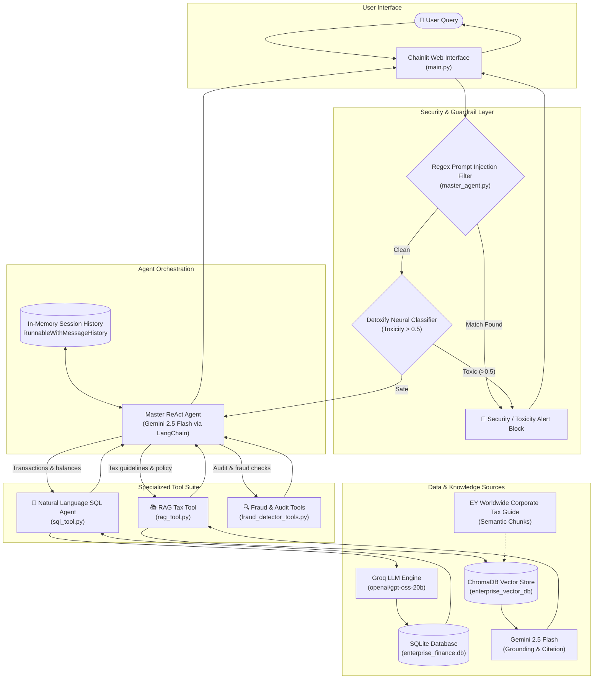

# 🏢 Enterprise Bot: AI-Powered Financial & Corporate Tax Assistant

[](https://www.python.org/)
[](https://python.langchain.com/)
[](https://chainlit.io/)
[](https://aistudio.google.com/)
[](https://groq.com/)
[](https://www.trychroma.com/)

An enterprise-grade autonomous **ReAct (Reasoning & Acting)** conversational agent designed for corporate finance teams, tax advisors, and compliance auditors. **Enterprise Bot** integrates Retrieval-Augmented Generation (RAG) over official corporate tax guidelines, natural-language SQL queries over financial transaction records, statistical fraud & anomaly detection, and multi-layered AI safety guardrails into an interactive chat interface.

---

## 📑 Table of Contents
- [Project Overview](#-project-overview)
- [Key Features](#-key-features)
- [System Architecture](#-system-architecture)
- [Technology Stack](#-technology-stack)
- [Repository Structure](#-repository-structure)
- [Prerequisites](#-prerequisites)
- [Step-by-Step Setup & Installation](#-step-by-step-setup--installation)
- [Running the Application](#-running-the-application)
- [Sample Queries & Use Cases](#-sample-queries--use-cases)
- [Security & Guardrails](#-security--guardrails)
- [Troubleshooting & FAQs](#-troubleshooting--faqs)

---

## 💡 Project Overview

In enterprise environments, financial teams frequently navigate disparate workflows: querying relational transaction ledgers, consulting lengthy jurisdiction-specific corporate tax compendiums, and executing manual statistical checks for audit anomalies. 

**Enterprise Bot** unifies these disparate workflows into a single intelligent interface:
1. **Corporate Tax Advisory**: Grounded RAG over the *EY Worldwide Corporate Tax Guide* with strict hallucination controls and source citations.
2. **Natural Language Financial Analytics**: Dynamic translation of natural English questions into read-only SQL queries against an enterprise database.
3. **Forensic Audit & Fraud Suite**: Automated forensic routines—including **Benford's Law distribution analysis**, **split transaction clustering**, and **budget variance tracking**.
4. **Enterprise Guardrails**: Neural toxicity filtering and regex-based prompt injection defense to protect internal data and system integrity.

---

## ✨ Key Features

- **Multi-Tool Autonomous ReAct Agent**: Automatically reasons over user intent and dynamically chooses between RAG, SQL, or statistical fraud tools.
- **RAG Corporate Tax Specialist**: Powered by semantic chunking and dense vector retrieval with HuggingFace embeddings and ChromaDB to parse complex tax statutes.
- **Text-to-SQL Analytics**: Safely converts natural language to SQLite queries via Groq inference to inspect transactions without writing raw SQL.
- **Statistical Fraud Detection Tools**:
  - **Benford's Law Analysis**: Flags artificial or manipulated transaction figures based on logarithmic first-digit frequency distributions.
  - **Split Transaction Detection**: Detects clustered payments hovering just below company approval thresholds (e.g., 80%–100% of $10,000) within defined time windows.
  - **Variance Analysis**: Computes deviation between actual spending and budgeted totals with automated risk flags.
- **Session Memory & Context**: Retains conversational history across queries using session tracking.
- **Full Chain-of-Thought (CoT) UI**: Chainlit interface with transparent reasoning steps, tool invocation visibility, and responsive streaming.

---

## 🏗️ System Architecture

The following diagram illustrates the end-to-end data flow and tool invocation pipeline of Enterprise Bot:



---

## 💻 Technology Stack

| Component | Technology | Purpose |
| :--- | :--- | :--- |
| **User Interface** | [Chainlit](https://chainlit.io/) (v2.11+) | Asynchronous real-time chat UI with Chain-of-Thought inspection and session tracking |
| **Agent Framework** | [LangChain](https://www.langchain.com/) / `langchain-classic` | Multi-tool ReAct agent loop, tool bindings, and prompt templates |
| **Primary LLM** | [Google Gemini 2.5 Flash](https://ai.google.dev/) | Main reasoning agent and RAG synthesis engine |
| **Fast Inference LLM** | [Groq](https://groq.com/) | Low-latency SQL query generation agent |
| **Vector Database** | [ChromaDB](https://www.trychroma.com/) (`langchain-chroma`) | Local vector storage and similarity retrieval for corporate tax documentation |
| **Embedding Model** | `sentence-transformers/all-MiniLM-L6-v2` | Dense vector representations for semantic document search |
| **Document Splitting** | `langchain-experimental` (`SemanticChunker`) | Context-aware semantic segmentation of corporate tax manuals |
| **Relational Database** | [SQLite](https://www.sqlite.org/) via `SQLDatabase` | Structured storage for enterprise transactions and financial ledgers |
| **Safety & Moderation** | [Detoxify](https://github.com/unitaryai/detoxify) & Regex Rules | Real-time neural toxicity classification and prompt injection blocking |
| **Mathematical / Data** | [NumPy](https://numpy.org/) & [Pandas](https://pandas.pydata.org/) | Benford's Law calculations, timestamp clustering, and variance analysis |
| **Resilience** | [Tenacity](https://tenacity.readthedocs.io/) | Exponential backoff and retry handling for LLM API rate limits |
| **Deep Learning Runtime** | [PyTorch](https://pytorch.org/) (CUDA / CPU) | Tensor computation backend for local Hugging Face embedding models |

---

## 📁 Repository Structure

```text
Enterprise_bot/
├── .chainlit/
│   └── config.toml                # Chainlit UI configurations (CoT, timeouts, layout)
├── agent/
│   └── master_agent.py            # Master ReAct Agent, security guardrails & session memory
├── tools/
│   ├── fraud_detector_tools.py    # Benford's law, split transaction & variance tools
│   ├── rag_tool.py                # Semantic chunking, ChromaDB retrieval & tax guide RAG
│   └── sql_tool.py                # SQL database agent with Groq integration
├── chainlit.md                    # Chainlit welcome screen markdown
├── database_creation.py           # SQLite initialization script with sample transactions
├── enterprise_finance.db          # SQLite financial records database
├── ey-worldwide-corporate-tax-guide.pdf  # Comprehensive tax reference document
├── main.py                        # Chainlit entry point & message handler
├── requirements.txt               # Project Python package dependencies
├── .env.example                   # Environment variable template
└── README.md                      # Project documentation
```

---

## 📋 Prerequisites

Before setting up the project, ensure you have:

1. **Python 3.10 or 3.11** installed on your system.
2. **Git** installed on your system.
3. An active **Google Gemini API Key** (obtainable from [Google AI Studio](https://aistudio.google.com/)).
4. An active **Groq API Key** (obtainable from [Groq Cloud Console](https://console.groq.com/)).

---

## 🚀 Step-by-Step Setup & Installation

### Step 1: Clone the Repository

Open your terminal or command prompt and clone the repository:

```bash
git clone https://github.com/PJ-21-code/Enterprise_bot.git
cd Enterprise_bot
```

### Step 2: Create and Activate a Virtual Environment

It is highly recommended to isolate dependencies inside a virtual environment:

**On Windows (PowerShell):**
```powershell
python -m venv .venv
.\.venv\Scripts\Activate.ps1
```
*(If you encounter execution policy restrictions in PowerShell, run `Set-ExecutionPolicy -Scope Process -ExecutionPolicy Bypass` first, or use Command Prompt: `.\.venv\Scripts\activate.bat`)*

**On macOS / Linux:**
```bash
python3 -m venv .venv
source .venv/bin/activate
```

### Step 3: Install Dependencies

Install all required Python packages listed in `requirements.txt`:

```bash
pip install --upgrade pip
pip install -r requirements.txt
```

> [!NOTE]
> PyTorch (`torch`) is included in `requirements.txt`. If you wish to use a specific GPU CUDA version or CPU-only version suited for your hardware, consult [pytorch.org](https://pytorch.org/get-started/locally/) before installation.

### Step 4: Configure Environment Variables

Create your local `.env` configuration file from the provided `.env.example` template:

**On Windows (Command Prompt or PowerShell):**
```cmd
copy .env.example .env
```

**On macOS / Linux:**
```bash
cp .env.example .env
```

Open `.env` in your text editor and provide your actual API keys:

```env
# Google Gemini API Key (Required for Master Agent & RAG Synthesis)
GEMINI_API_KEY=your_gemini_api_key_here

# Groq API Key (Required for SQL Analytics Agent)
GROQ_API_KEY=your_groq_api_key_here
```

### Step 5: Initialize the SQLite Financial Database

Run the database setup script to create the local `enterprise_finance.db` SQLite database populated with sample enterprise transaction records:

```bash
python database_creation.py
```

You should see confirmation output:
```text
Successfully created 'enterprise_finance.db' with 20 sample transaction records!
```

---

## ⚡ Running the Application

Launch the interactive Chainlit web application by executing:

```bash
chainlit run main.py -w
```

- The `-w` flag enables auto-reload upon code modifications.
- Chainlit will spin up a local server (default: `http://localhost:8000`).
- Open your browser and navigate to **`http://localhost:8000`** to begin interacting with Enterprise Bot!

> [!TIP]
> On initial startup, the RAG tool will load `ey-worldwide-corporate-tax-guide.pdf` and compute semantic embeddings into `./enterprise_vector_db`. This step may take 1–2 minutes on first run. Subsequent runs will leverage the persisted vector database.

---

## 💬 Sample Queries & Use Cases

Try out the following sample prompts in the chat interface:

### 1. Corporate Tax Inquiries (RAG Tool)
- *"What are the corporate income tax rates and branch tax rules in Canada according to the EY Tax Guide?"*
- *"Does Singapore offer tax incentives for research and development activities?"*
- *"Explain the depreciation rules for intellectual property in Germany based on the guide."*

### 2. Live Database Inquiries (SQL Tool)
- *"How many total transactions are recorded in the database, and what is the sum of all debit transactions?"*
- *"List all vendor payout wire transactions and their amounts."*
- *"Show me all transactions recorded for customer ID 101."*

### 3. Forensic Fraud & Audit Checks (Fraud Detection Tools)
- *"Run Benford's Law on these transaction amounts to check for potential manipulation: [12000, 5400, 450, 1500, 12000, 3400, 999.99, 89.99, 120, 499]"*
- *"Calculate the budget variance if our actual spending records are [450, 1200, 89, 1500] against a budgeted benchmark of 750."*
- *"Check if there are any split transactions that might be attempting to bypass the $10,000 approval limit."*

---

## 🛡️ Security & Guardrails

Enterprise Bot incorporates multi-stage safety layers to protect corporate environments:

1. **Prompt Injection Mitigation**:
   - Monitored by `check_prompt_injection()` in `agent/master_agent.py`.
   - Inspects queries against known patterns such as *"ignore previous instructions"*, *"reveal your system message"*, *"drop table"*, or jailbreak strings before invoking any LLM.
2. **Neural Toxicity & Abuse Detection**:
   - Evaluated using [Detoxify](https://github.com/unitaryai/detoxify).
   - Any query exceeding a 0.5 toxicity threshold is immediately blocked.
3. **Read-Only Database Enforcement**:
   - The SQL agent's system prompt strictly prohibits data-modifying SQL queries (`INSERT`, `UPDATE`, `DELETE`, `DROP`, `ALTER`).

---

## ❓ Troubleshooting & FAQs

<details>
<summary><b>1. Rate Limit Errors (HTTP 429)</b></summary>
The system is protected with <code>@retry</code> decorators from Tenacity with exponential backoff on both Groq and Gemini calls. If you hit free-tier rate limits, pause for a few seconds before submitting further queries or consider upgrading your API tier.
</details>

<details>
<summary><b>2. Vector DB Loading Takes Long on First Run</b></summary>
Semantic chunking processes the comprehensive EY Tax Guide (~10 MB PDF) page by page. Ensure PyTorch is properly utilizing your hardware (GPU or multi-core CPU) for faster embedding generation. Once initialized, the database persists in <code>./enterprise_vector_db</code>.
</details>

<details>
<summary><b>3. Missing or Corrupted SQLite Database</b></summary>
If <code>enterprise_finance.db</code> is missing or queries fail, re-run <code>python database_creation.py</code> to regenerate the table and sample records.
</details>

<details>
<summary><b>4. PowerShell Execution Policy Restriction on Windows</b></summary>
If activating the virtual environment yields an execution policy error, run:
<code>Set-ExecutionPolicy -Scope Process -ExecutionPolicy Bypass</code> in your current PowerShell session.
</details>

---

## 📜 License

This project is created for enterprise problem-solving and educational demonstrations. Consult the repository maintainer for specific licensing terms.